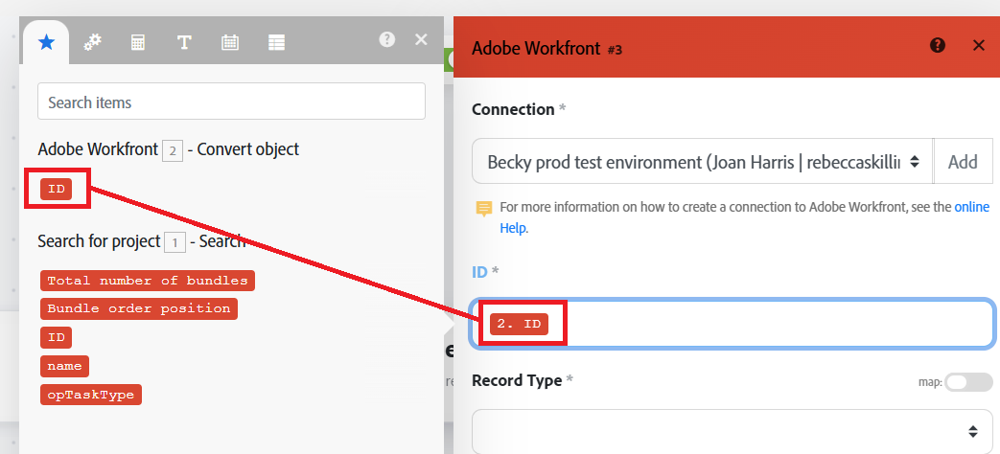
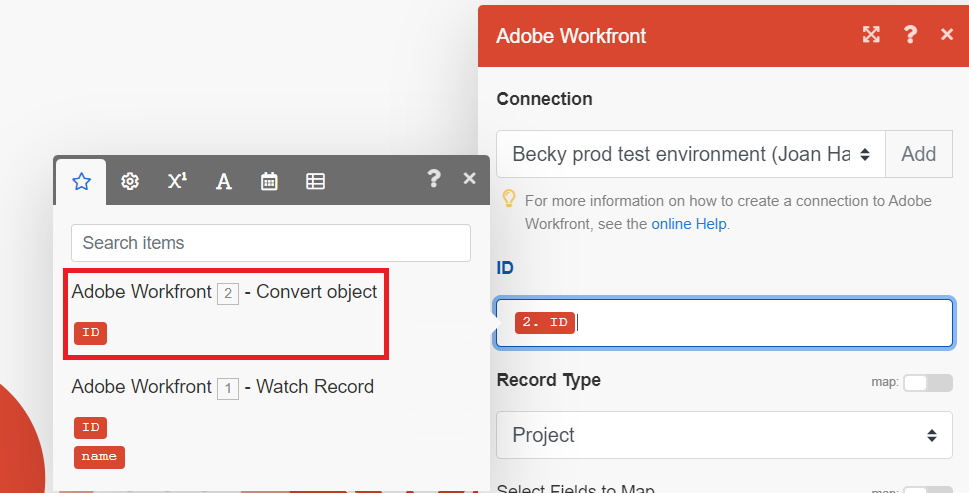

# Usar função para atualizar um projeto em um cenário básico

Atualizar um item de trabalho do Workfront é um caso de uso comum para o Workfront Fusion. Neste exemplo, você usará uma função para alterar o nome de um projeto para ficar em letras maiúsculas.

O Fusion inclui muitos tipos de funções que permitem transformar e executar lógica condicional em seus dados. Para obter mais informações sobre o uso de funções, consulte [Visão geral da função](/help/workfront-fusion/get-started-with-fusion/understand-fusion/function-overview.md).

Este exemplo modifica o cenário criado em [Criar um cenário básico](/help/workfront-fusion/build-practice-scenarios/create-basic-scenario.md).

>[!NOTE]
>
>O Workfront Fusion está fazendo a transição do editor de cenários para uma nova experiência. Durante essa transição, as experiências clássicas e novas estão disponíveis e você pode alternar entre elas a qualquer momento. Recomendamos usar a nova experiência. Para obter mais informações, consulte [Experiências novas e clássicas](/help/workfront-fusion/get-started-with-fusion/navigate-fusion/scenario-editor.md#new-and-classic-experiences) no artigo Editor de cenários.

## Requisitos de acesso

+++ Expanda para visualizar os requisitos de acesso da funcionalidade neste artigo.

<table style="table-layout:auto">
 <col> 
 <col> 
 <tbody> 
  <tr> 
   <td role="rowheader">Pacote do Adobe Workfront</td> 
   <td> 
Qualquer pacote de fluxo de trabalho do Adobe Workfront e qualquer pacote do Adobe Workfront Automation and Integration

Workfront Ultimate

Os pacotes Workfront Prime e Select, com uma compra adicional do Workfront Fusion.
 </td> 
  </tr> 
  <tr data-mc-conditions=""> 
   <td role="rowheader">Licenças do Adobe Workfront</td> 
   <td> 
Padrão

Trabalho ou maior
 </td> 
  </tr> 
  <tr> 
   <td role="rowheader">Produto</td> 
   <td>
   
Se sua organização tiver um pacote Workfront Select ou Prime, ele não inclui o Workfront Automation and Integration. É necessário comprar o Adobe Workfront Fusion.</li></ul>
   </td> 
  </tr>
 </tbody> 
</table>

Para obter mais detalhes sobre as informações contidas nesta tabela, consulte [Requisitos de acesso na documentação](/help/workfront-fusion/references/licenses-and-roles/access-level-requirements-in-documentation.md).

+++

## Pré-requisitos

Você deve criar o cenário descrito em [Criar um cenário básico](/help/workfront-fusion/build-practice-scenarios/create-basic-scenario.md) antes de seguir este procedimento.

## Usar uma função para atualizar um projeto na nova experiência do (recomendado)

* [Adicionar o módulo Atualizar um registro ao seu cenário](#add-the-update-a-record-module-to-your-scenario)
* [Mapear a função para a atualização de nome](#map-the-function-for-the-name-update)
* [Testar e ativar](#test-and-activate)

### Adicionar o módulo Atualizar um registro ao seu cenário

1. Abra o cenário no editor de cenários.
1. Passe o mouse sobre a borda direita do segundo módulo, em seguida, clique em **[!UICONTROL Adicionar outro módulo]** quando ele aparecer.
1. Selecione Adobe Workfront na lista de aplicativos e escolha o módulo **[!UICONTROL Atualizar um registro]**.
1. No campo ID, selecione o bloco de ID que está sob o módulo de objeto Converter. Esta é a ID do projeto emitido por esse módulo.

   

1. No campo Tipo de registro, selecione Projeto, pois o objeto a ser atualizado é um projeto.
1. Na área Selecionar campos a serem mapeados, selecione Nome.

   Um campo Nome será aberto.
1. Continue para [Mapear a função para a atualização de nome](#map-the-function-for-the-name-update).

### Mapear a função para a atualização de nome

Quando esse cenário converte uma solicitação em um projeto, o nome do projeto é igual ao da solicitação. A função aqui pega esse nome e coloca todas as letras em maiúsculas nele.

1. Clique no campo **Nome**.

   O painel de mapeamento é aberto.
1. No painel de mapeamento, clique no ícone **Funções binárias e de texto**. 
1. Selecione a função **upper**.

   A função aparece no campo Nome, incluindo a formatação da entrada esperada.

   A entrada para este exemplo é o nome do problema do qual o projeto foi convertido.

1. Mova o cursor entre os parênteses, porque é para onde a entrada irá.
1. No painel de mapeamento, clique no ícone **Saída do módulo**. 
1. Selecione o bloco de nome que foi emitido pelo primeiro módulo.

   O bloco de nome aparece na função.

   

1. Clique em **OK** para salvar as configurações do módulo.

### Testar e ativar

1. Teste o cenário clicando no ícone **[!UICONTROL Executar uma vez]**.

   Executar uma vez é somente para ícones na nova experiência do. Passe o mouse sobre o ícone para ver a dica de ferramenta **[!UICONTROL Executar uma vez]**.

   

1. Examine a saída para garantir que o cenário seja executado conforme esperado.
1. Quando estiver satisfeito com o funcionamento do cenário, clique no botão **Agendamento** para **Ligado**.

   Isso ativa o cenário. Cenários ativos são executados de acordo com o agendamento definido no módulo do acionador.

   

1. Clique no ícone **Salvar**  na área Controles para salvar seu progresso no cenário.

   >[!IMPORTANT]
   >
   >Salve com frequência à medida que você aprimora e testa um cenário. Talvez seja necessário criar um novo problema em sua conta da Workfront para acionar o cenário.

## Use uma função para atualizar um projeto na experiência clássica

* [Adicionar o módulo Atualizar um registro ao seu cenário (Clássico)](#add-the-update-a-record-module-to-your-scenario-classic)
* [Mapear a função para a atualização de nome (Clássico)](#map-the-function-for-the-name-update-classic)
* [Testar e ativar (Clássico)](#test-and-activate-classic)

### Adicionar o módulo Atualizar um registro ao seu cenário (Clássico)

1. Abra o cenário no editor de cenários.
1. Passe o mouse sobre o círculo parcial à direita do do segundo módulo e clique em **[!UICONTROL Adicionar outro módulo]**.
1. Selecione Adobe Workfront na lista de aplicativos e escolha o módulo **[!UICONTROL Atualizar um registro]**.
1. No campo ID, selecione o bloco de ID que está sob o módulo de objeto Converter. Esta é a ID do projeto emitido por esse módulo.

   

1. No campo Tipo de registro, selecione Projeto, pois o objeto a ser atualizado é um projeto.
1. Na área Selecionar campos a serem mapeados, selecione Nome.

   Um campo Nome será aberto.
1. Continue para [Mapear a função para a atualização de nome (Clássica)](#map-the-function-for-the-name-update-classic).

### Mapear a função para a atualização de nome (Clássico)

Quando esse cenário converte uma solicitação em um projeto, o nome do projeto é igual ao da solicitação. A função aqui pega esse nome e coloca todas as letras em maiúsculas nele.

1. Clique no campo **Nome**.

   O painel de mapeamento é aberto.
1. No painel de mapeamento, clique no ícone **Funções binárias e de texto**. 
1. Selecione a função **upper**.

   A função aparece no campo Nome, incluindo a formatação da entrada esperada.

   A entrada para este exemplo é o nome do problema do qual o projeto foi convertido.

1. Mova o cursor entre os parênteses, porque é para onde a entrada irá.
1. No painel de mapeamento, clique no ícone **Saída do módulo**. 
1. Selecione o bloco de nome que foi emitido pelo primeiro módulo.

   O bloco de nome aparece na função.

   

1. Clique em **OK** para salvar as configurações do módulo.

### Testar e ativar (Clássico)

1. Teste o cenário clicando em **Executar uma vez** no canto inferior esquerdo da tela.
1. Examine a saída para garantir que o cenário seja executado conforme esperado.
1. Quando estiver satisfeito com o funcionamento do cenário, clique no botão de alternância **Agendamento** no canto inferior esquerdo da tela para **Ativado**.

   Isso ativa o cenário. Cenários ativos são executados de acordo com o agendamento definido no módulo do acionador.
1. No Workfront Fusion, clique em **[!UICONTROL Salvar]** próximo ao canto inferior esquerdo para salvar seu progresso no cenário.

   >[!IMPORTANT]
   >
   >Salve com frequência à medida que você aprimora e testa um cenário. Talvez seja necessário criar um novo problema em sua conta da Workfront para acionar o cenário.

## Recursos

* [Mapear itens usando funções integradas](/help//workfront-fusion/create-scenarios/map-data/map-using-functions.md)
