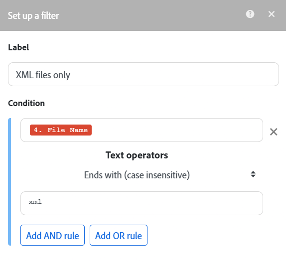

# Adicionar filtro a um cenário

Em alguns cenários, é necessário trabalhar somente com pacotes que atendam a critérios específicos. Os filtros permitem selecionar esses pacotes.

Por exemplo, você pode criar um cenário com o acionador [!UICONTROL Registros de observação] para que o Workfront capture apenas tarefas atribuídas a um usuário específico.

Você pode adicionar um filtro entre dois módulos e verificar se os pacotes recebidos dos módulos anteriores atendem a condições de filtro específicas:

* Se isso acontecer, os pacotes serão transmitidos para o próximo módulo no cenário.
* Caso contrário, o processamento dos pacotes será encerrado.

>[!NOTE]
>
>O Workfront Fusion está fazendo a transição do editor de cenários para uma nova experiência. Durante essa transição, as experiências clássicas e novas estão disponíveis e você pode alternar entre elas a qualquer momento. Recomendamos usar a nova experiência. Para obter mais informações, consulte [Experiências novas e clássicas](/help/workfront-fusion/get-started-with-fusion/navigate-fusion/scenario-editor.md#new-and-classic-experiences) no artigo Editor de cenários.

## Requisitos de acesso

+++ Expanda para visualizar os requisitos de acesso da funcionalidade neste artigo.

<table style="table-layout:auto">
 <col> 
 <col> 
 <tbody> 
  <tr> 
   <td role="rowheader">Pacote do Adobe Workfront</td> 
   <td> 
Qualquer pacote de fluxo de trabalho do Adobe Workfront e qualquer pacote do Adobe Workfront Automation and Integration

Workfront Ultimate

Os pacotes Workfront Prime e Select, com uma compra adicional do Workfront Fusion.
 </td> 
  </tr> 
  <tr data-mc-conditions=""> 
   <td role="rowheader">Licenças do Adobe Workfront</td> 
   <td> 
Padrão

Trabalho ou maior
 </td> 
  </tr> 
  <tr> 
   <td role="rowheader">Produto</td> 
   <td>
   
Se sua organização tiver um pacote Workfront Select ou Prime, ele não inclui o Workfront Automation and Integration. É necessário comprar o Adobe Workfront Fusion.</li></ul>
   </td> 
  </tr>
 </tbody> 
</table>

Para obter mais detalhes sobre as informações contidas nesta tabela, consulte [Requisitos de acesso na documentação](/help/workfront-fusion/references/licenses-and-roles/access-level-requirements-in-documentation.md).

+++

## Pré-requisitos

Você deve adicionar ambos os módulos a um cenário antes de poder adicionar um filtro entre eles.

## Adicionar um filtro entre dois módulos

* [Adicionar um filtro entre dois módulos na nova experiência do (recomendado)](#add-a-filter-between-two-modules-in-the-new-experience-recommended)
* [Adicionar um filtro entre dois módulos na experiência clássica](#add-a-filter-between-two-modules-in-the-classic-experience)

### Adicionar um filtro entre dois módulos na nova experiência do (recomendado)

1. Clique na guia **[!UICONTROL Cenários]** no painel esquerdo.
1. Selecione o cenário ao qual deseja adicionar um filtro.
1. Clique em qualquer lugar no cenário para entrar no editor de cenários.
1. Clique com o botão esquerdo do mouse no caminho entre os módulos em que deseja adicionar um filtro.

   A janela **[!UICONTROL Configurar um filtro]** é aberta diretamente. (Clicar com o botão direito do mouse no caminho abre um menu diferente.)

1. Na caixa que é exibida, digite um **[!UICONTROL Rótulo]** para o filtro.
1. Defina o filtro **[!UICONTROL Condição]**.

   Insira o campo pelo qual você deseja filtrar no primeiro campo, o operador e (se necessário) o valor ao qual você deseja comparar o campo.

   >[!TIP]
   >
   >É possível inserir valores em campos de filtro no painel de mapeamento
   >Para obter mais informações sobre mapeamento, consulte [Mapear informações de um módulo para outro](/help/workfront-fusion/create-scenarios/map-data/map-data-from-one-to-another.md).

   Por exemplo, se você deseja que o filtro passe arquivos no Adobe Workfront terminando em XML, você deve digitar **[!UICONTROL Nome do arquivo]** na primeira caixa e .**[!UICONTROL xml]** na segunda caixa. No menu suspenso entre elas, você selecionaria **[!UICONTROL Termina com (sem distinção entre maiúsculas e minúsculas)]**. Esse filtro se aplicaria aos pacotes recebidos do primeiro módulo (Workfront). Somente pacotes contendo arquivos XML passariam para o módulo seguinte.

   

1. Clique em **[!DNL OK]**.

### Adicionar um filtro entre dois módulos na experiência clássica

1. Clique na guia **[!UICONTROL Cenários]** no painel esquerdo.
1. Selecione o cenário ao qual deseja adicionar um filtro.
1. Clique em qualquer lugar no cenário para entrar no editor de cenários.
1. Clique no ícone de chave inglesa  entre os módulos aos quais deseja adicionar um filtro e selecione **Configurar um filtro**.
1. Na caixa que é exibida, digite um **[!UICONTROL Rótulo]** para o filtro.
1. Defina o filtro **[!UICONTROL Condição]**.

   Insira o campo pelo qual você deseja filtrar no primeiro campo, o operador e (se necessário) o valor ao qual você deseja comparar o campo.

   >[!TIP]
   >
   >É possível inserir valores em campos de filtro no painel de mapeamento
   >Para obter mais informações sobre mapeamento, consulte [Mapear informações de um módulo para outro](/help/workfront-fusion/create-scenarios/map-data/map-data-from-one-to-another.md).

   Por exemplo, se você deseja que o filtro passe arquivos no Adobe Workfront terminando em XML, você deve digitar **[!UICONTROL Nome do arquivo]** na primeira caixa e .**[!UICONTROL xml]** na segunda caixa. No menu suspenso entre elas, você selecionaria **[!UICONTROL Termina com (sem distinção entre maiúsculas e minúsculas)]**. Esse filtro se aplicaria aos pacotes recebidos do primeiro módulo (Workfront). Somente pacotes contendo arquivos XML passariam para o módulo seguinte.

   

1. Clique em **[!DNL OK]**.

## Copiar um filtro

Você pode copiar um filtro existente e colá-lo em outro lugar do cenário.

* [Copiar um filtro na nova experiência (Recomendado)](#copy-a-filter-in-the-new-experience-recommended)
* [Copiar um filtro na experiência clássica](#copy-a-filter-in-the-classic-experience)

### Copiar um filtro na nova experiência (Recomendado)

1. Clique na guia **[!UICONTROL Cenários]** no painel esquerdo.
1. Selecione o cenário ao qual deseja adicionar um filtro.
1. Clique em qualquer lugar no cenário para entrar no editor de cenários.
1. Clique com o botão direito do mouse no caminho entre os módulos onde o filtro está localizado.
1. Selecione **Copiar filtro**.
1. Clique com o botão direito do mouse no caminho entre os módulos em que deseja colar o filtro.
1. Selecione **Colar filtro**.
1. (Opcional) Para ajustar o filtro, clique no ícone de filtro ou rótulo e insira valores conforme descrito em [Adicionar um filtro entre dois módulos na nova experiência](#add-a-filter-between-two-modules-in-the-new-experience-recommended) neste artigo.

### Copiar um filtro na experiência clássica

1. Clique na guia **[!UICONTROL Cenários]** no painel esquerdo.
1. Selecione o cenário ao qual deseja adicionar um filtro.
1. Clique em qualquer lugar no cenário para entrar no editor de cenários.
1. Clique com o botão direito do mouse nos pontos de conexão entre módulos onde o filtro está localizado.
1. Selecione **Copiar filtro**.
1. Clique com o botão direito do mouse nos pontos de conexão entre módulos nos quais deseja colar o filtro.
1. Selecionar filtro **Colar**
1. (Opcional) Para ajustar o filtro, clique no ícone de filtro ou rótulo e insira valores conforme descrito em [Adicionar um filtro entre dois módulos na experiência clássica](#add-a-filter-between-two-modules-in-the-classic-experience) neste artigo.

<!--

Currently, the scenario editor does include a feature for copying a filter.

>[!NOTE]
>
>If you copy the modules on either side of the filter, the filter is also copied.
>
>For more information on copying modules, see [Copy modules or scenarios in Adobe Workfront Fusion](/help/workfront-fusion/create-scenarios/add-modules/copy-modules-or-scenarios.md).

To copy a filter without copying modules, you can use the Fusion DevTool

1. Click the **[!UICONTROL Scenarios]** tab in the left panel.
1. Select the scenario where you want to add a filter.
1. Click anywhere on the scenario to enter the Scenario editor.
1. Open the Fusion DevTool by clicking on the DevTool icon  near the bottom of the screen.
   
   If you do not see the DevTool icon, see [Debug a scenario](/help/workfront-fusion/manage-scenarios/debug-a-scenario.md) for instructions on opening the DevTool.
   
1. Click the **[!UICONTROL Tools]** icon  in the left side bar.

1. Click **[!UICONTROL Copy Filter]**, then configure the **[!UICONTROL Copy Filter]** tool in the right side panel:

   1. Set the **[!UICONTROL Source Module]** as the module directly after the filter you want to copy.
   1. Set the **[!UICONTROL Target Module]** as the module that you want to place the filter directly after.

1. Click **[!UICONTROL Run]**.

-->
