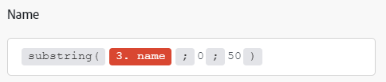
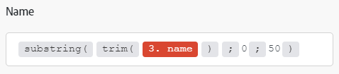
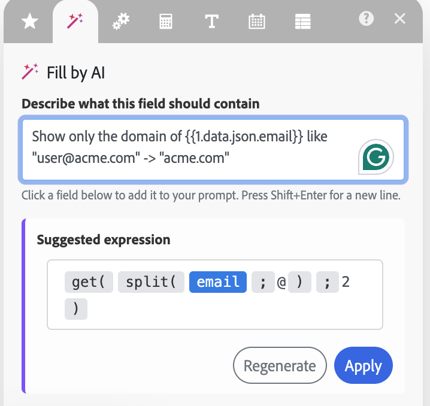
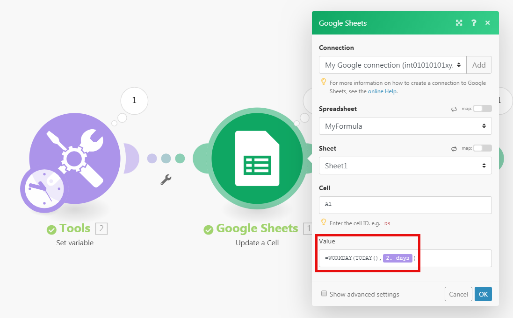

# Mapear um item usando funções integradas

O Workfront Fusion inclui funções integradas que permitem criar fórmulas simples ou complexas. Essas funções cobrem uma grande variedade de casos de uso, incluindo funções para matrizes, sequências, números e dados de módulos anteriores.

Além disso, é possível criar funções e pacotes personalizados que seus cenários poderão usar para transformar e manipular dados.

Para obter informações e instruções sobre funções personalizadas, consulte [Mapear dados usando funções personalizadas](/help/workfront-fusion/create-scenarios/map-data/map-using-custom-functions.md).

Para obter informações e instruções sobre pacotes de função, consulte [Usar pacotes de função personalizados](/help/workfront-fusion/create-scenarios/map-data/use-custom-function-packages.md).

## Requisitos de acesso

+++ Expanda para visualizar os requisitos de acesso da funcionalidade neste artigo.

<table style="table-layout:auto">
 <col> 
 <col> 
 <tbody> 
  <tr> 
   <td role="rowheader">Pacote do Adobe Workfront</td> 
   <td> 
Qualquer pacote de fluxo de trabalho do Adobe Workfront e qualquer pacote do Adobe Workfront Automation and Integration

Workfront Ultimate

Os pacotes Workfront Prime e Select, com uma compra adicional do Workfront Fusion.
 </td> 
  </tr> 
  <tr data-mc-conditions=""> 
   <td role="rowheader">Licenças do Adobe Workfront</td> 
   <td> 
Padrão

Trabalho ou maior
 </td> 
  </tr> 
  <tr> 
   <td role="rowheader">Produto</td> 
   <td>
   
<ul><li>Se sua organização tiver um pacote Workfront Select ou Prime, ele não inclui o Workfront Automation and Integration. É necessário comprar o Adobe Workfront Fusion.</li><li>Você deve ter uma licença do Adobe App Builder para usar funções personalizadas.</ul>
   </td> 
  </tr>
 </tbody> 
</table>

Para obter mais detalhes sobre as informações contidas nesta tabela, consulte [Requisitos de acesso na documentação](/help/workfront-fusion/references/licenses-and-roles/access-level-requirements-in-documentation.md).

+++

## Mapear dados usando funções integradas

Ao mapear itens, você pode usar funções para criar fórmulas simples ou complexas. As funções disponíveis são semelhantes às funções no Excel e em algumas linguagens de programação:

* Elas avaliam lógica geral, matemática, texto, datas e matrizes.
* Elas permitem executar lógica condicional e transformações de valores de item, como converter um texto em maiúsculas, aparar texto, converter uma data em um formato diferente e muito mais.

### Inserir funções em campos

Para inserir uma função em um campo:

1. Clique na guia **[!UICONTROL Cenários]** no painel esquerdo.
1. Selecione o cenário em que deseja mapear dados.
1. Clique em qualquer lugar no cenário para entrar no editor de cenários.
1. Clique no campo onde deseja inserir uma função.
1. Selecione a guia no painel de mapeamento que contém a função que você deseja inserir.

   Para obter informações sobre guias do painel de mapeamento, consulte [Visão geral da função](/help/workfront-fusion/get-started-with-fusion/understand-fusion/function-overview.md)
1. Clique no nome da função.

   Ou

   Arraste a função para o campo.
1. Configure os parâmetros da função.

   Para obter uma explicação dos parâmetros da função, passe o mouse sobre a função no painel de mapeamento.

   Para obter mais informações sobre funções e seus parâmetros, consulte os artigos em [Referências da função: índice do artigo](/help/workfront-fusion/references/mapping-panel/functions/functions-toc.md).

1. Continue a configurar o módulo ou clique em **OK**.

>[!TIP]
>
>Ao criar uma fórmula complexa que deseja reutilizar em outro campo, você pode clicar no campo que contém a combinação, usar Cmd-A ou Ctrl-A para selecioná-lo e, em seguida, copiá-lo e colá-lo no outro campo.

>[!BEGINSHADEBOX]

**Exemplo:** alguns tipos de dados impedem que os usuários insiram mais do que um determinado número de caracteres. Você pode usar a função substring para limitar um valor a um determinado número de caracteres.

Neste exemplo, a função de subsequência de caracteres limita o nome do projeto a 50 caracteres.

>[!ENDSHADEBOX]

### Aninhamento de funções

É possível aninhar funções entre si.

>[!BEGINSHADEBOX]

**Exemplo:**

Neste exemplo, a função substring limita o nome do projeto aparado a 50 caracteres.

>[!ENDSHADEBOX]

Para aninhar uma função:

1. Clique no campo onde você está criando uma fórmula.

   Isso abre o painel de mapeamento.

1. Clique na primeira função que deseja adicionar. Esta é a função no exterior. No exemplo a seguir, esta é a função `substring`.
1. Nessa função, clique para onde deseja que a função aninhada vá. Neste exemplo, a função aninhada vai no lugar do primeiro parâmetro.
1. No painel de mapeamento, clique na função aninhada. Neste exemplo, esta é a função `trim`.
1. Continue a configurar a função conforme desejado.
1. Continue a configurar o módulo ou clique em **OK**.

### Gerar uma expressão com IA

Em vez de escrever a sintaxe de uma expressão você mesmo, pode descrever o que deseja em linguagem simples, e a IA gera a expressão para você. Por exemplo, você pode solicitar o seguinte:

* Una esses nomes com uma vírgula.
* Adicione três dias à data de vencimento.

A IA transforma sua solicitação em uma expressão que usa as funções integradas do Workfront Fusion, para que o resultado seja legível e fácil de revisar antes de usá-lo.

Para gerar uma expressão:

1. Clique na guia **[!UICONTROL Cenários]** no painel esquerdo.
1. Selecione o cenário em que deseja mapear dados.
1. Clique em qualquer lugar no cenário para entrar no editor de cenários.
1. Clique no módulo em que deseja adicionar uma expressão e clique no campo.

   O painel de mapeamento é aberto.

1. Clique na guia **[!UICONTROL Preencher por IA]** (o ícone de varinha mágica) no painel de mapeamento.

   

1. Na caixa **[!UICONTROL Descrever o que este campo deve conter]**, descreva o resultado desejado em linguagem simples.

   Para adicionar um campo de um módulo anterior ao seu prompt, clique nele na lista **[!UICONTROL Campos disponíveis]**. Para iniciar uma nova linha no prompt, pressione Shift+Enter.

   Por exemplo, para obter somente o domínio de um endereço de email, você pode inserir o seguinte prompt:

   `Show only the domain of {{1.data.json.email}} like "user@acme.com" -> "acme.com"`

1. Clique em **[!UICONTROL Gerar]**.

   A expressão gerada pela IA aparece em **[!UICONTROL Expressão sugerida]**.

   

1. Revise a expressão e siga um destes procedimentos:

   * Clique em **[!UICONTROL Aplicar]** para inserir a expressão no campo.
   * Clique em **[!UICONTROL Regenerar]** para que a IA gere uma expressão diferente.

1. (Opcional) Edite a expressão no campo, se desejar.

1. Continue a configurar o módulo ou clique em **[!UICONTROL OK]**.

#### Como a IA gera expressões

Quando a IA gera uma expressão, ela faz o seguinte:

* **Usa o contexto do seu cenário.** A IA considera os campos disponíveis para mapeamento, seus tipos, o campo de destino e suas configurações de local e fuso horário.
* **Valida a expressão.** Antes de o AI retornar uma expressão como bem-sucedida, ele verifica se há funções não compatíveis, argumentos ausentes, referências de campos desconhecidas e erros comuns em matrizes e datas.
* **Corrige e simplifica a expressão.** A IA corrige erros comuns de sintaxe e substitui soluções alternativas reconhecidas por funções integradas.
* **Tente novamente se a validação falhar.** A IA usa o feedback específico da validação para regenerar a expressão. Se ainda não for possível criar uma expressão válida, retornará um erro claro em vez de um resultado inválido.

>[!NOTE]
>
>As expressões geradas por IA podem estar incompletas ou imprecisas. Revise cada expressão e teste seu cenário antes de confiar no resultado.

### Usar funções [!DNL Google Sheets]

Se o Workfront Fusion não apresentar uma função que você queira usar, mas que seja apresentada por [!DNL Google Sheets], você poderá usá-la seguindo estas etapas:

1. Em [!DNL Google Sheets], crie uma nova planilha vazia.
1. No Workfront Fusion, abra o cenário.
1. Adicione o módulo **[!DNL Google Sheets]** >**[!UICONTROL Atualizar uma célula]** ao cenário.

1. Configure o módulo:

   1. Escolha a planilha recém-criada no campo **[!UICONTROL Planilha]**.
   1. Insira a fórmula que contém as funções [!DNL Google Sheets] no campo **[!UICONTROL Valor]**.

      Você pode usar a saída dos módulos anteriores como de costume.

      

1. Insira o módulo **[!UICONTROL Google Sheets] >[!UICONTROL Get a cell]** para obter o resultado calculado.
1. Configure o módulo, usando a mesma ID de célula que você usou na etapa 4.

   

