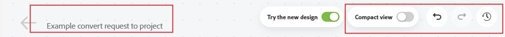
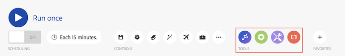

# O editor de cenários

O editor de cenários permite criar e editar cenários em uma interface visual.

A nova experiência do editor de cenários:

A experiência clássica do editor de cenários

## Requisitos de acesso

+++ Expanda para visualizar os requisitos de acesso da funcionalidade neste artigo.

<table style="table-layout:auto">
 <col> 
 <col> 
 <tbody> 
  <tr> 
   <td role="rowheader">Pacote do Adobe Workfront</td> 
   <td> 
Qualquer pacote de fluxo de trabalho do Adobe Workfront e qualquer pacote do Adobe Workfront Automation and Integration

Workfront Ultimate

Os pacotes Workfront Prime e Select, com uma compra adicional do Workfront Fusion.
 </td> 
  </tr> 
  <tr data-mc-conditions=""> 
   <td role="rowheader">Licenças do Adobe Workfront</td> 
   <td> 
Padrão

Trabalho ou maior
 </td> 
  </tr> 
  <tr> 
   <td role="rowheader">Produto</td> 
   <td>
   
Se sua organização tiver um pacote Workfront Select ou Prime, ele não inclui o Workfront Automation and Integration. É necessário comprar o Adobe Workfront Fusion.</li></ul>
   </td> 
  </tr>
 </tbody> 
</table>

Para obter mais detalhes sobre as informações contidas nesta tabela, consulte [Requisitos de acesso na documentação](/help/workfront-fusion/references/licenses-and-roles/access-level-requirements-in-documentation.md).

+++

## Experiências novas e clássicas

O Workfront Fusion está fazendo a transição do editor de cenários para uma nova experiência. Durante essa transição, as experiências clássicas e novas estão disponíveis e você pode alternar entre elas a qualquer momento. Recomendamos usar a nova experiência.

A nova experiência inclui:

* Uma tela redesenhada, com módulos de estilo de placa, um minimapa e controles de zoom.
* Novos controles do editor de cenários, incluindo Localizar e substituir, Trechos e Desfazer/Refazer.
* Um botão Perguntar à IA.
* Um seletor de conector atualizado com navegação de categoria e a capacidade de marcar favoritos em linha.
* Um modo escuro que segue sua configuração de aparência.
* A capacidade de dobrar um roteador para ocultar suas rotas.
* [Trilha em tempo real](/help/workfront-fusion/manage-scenarios/live-trail.md), um painel que mostra um cenário a ser executado à medida que ocorre.
* Várias Ferramentas de desenvolvedor que agora estão integradas ao editor de cenários.
* Logs de depuração temporários, que podem ser ativados nas configurações do cenário.

Para alternar entre as experiências clássica e nova:

1. No editor de cenários, localize o botão **[!UICONTROL Tentar o novo design]** no canto superior direito.
1. Clique no botão de alternância para alternar para a nova experiência.
1. Para retornar à experiência clássica, clique no botão de alternância novamente.

O cenário é recarregado quando você alterna. Sua escolha é salva para o usuário, de modo que não altera a experiência que seus colegas de equipe veem. A alternância não altera o cenário em si.

Se você não vir o botão de alternância, a nova experiência pode ainda não estar disponível para a sua organização. Entre em contato com o administrador do Workfront Fusion.

## Usar o editor de cenários na nova experiência (recomendado)

* [Abra o editor de cenários e adicione um módulo:](#open-the-scenario-editor-and-add-a-module)
* [Ações disponíveis do editor de cenário](#available-scenario-editor-actions)

### Abra o editor de cenários e adicione um módulo:

1. Clique em **[!UICONTROL Cenários]**  no painel esquerdo.
1. Clique no módulo de espaço reservado para abrir a lista de aplicativos e serviços.
1. Selecione o aplicativo ou serviço com o qual deseja começar:

   * Navegue por categoria usando o painel à esquerda ([!UICONTROL Favoritos], [!UICONTROL Todos os aplicativos], [!UICONTROL Adobe Workfront], [!UICONTROL Adobe Firefly Services], [!UICONTROL Adobe Creative e Conteúdo], [!UICONTROL Adobe Cloud Services], [!UICONTROL IA Gerativa] ou [!UICONTROL Interno]).
   * Insira um termo na caixa de pesquisa para filtrar a lista.
   * Para adicionar um conector aos favoritos, passe o mouse sobre o conector e clique no ícone de estrela ao lado do conector.

   Para obter informações detalhadas sobre como configurar um módulo, consulte [Configurar um módulo](/help/workfront-fusion/create-scenarios/add-modules/configure-a-modules-settings.md).

### Ações disponíveis do editor de cenário

* [Edição de ações](#editing-actions)
* [Agendamento](#scheduling)
* [Controles](#controls)
* [Ferramentas](#tools)
* [Favoritos](#favorites)
* [Solicitar IA](#ask-ai)
* [Navegação da tela de desenho](#canvas-navigation)
* [Exibição da tela](#canvas-display)

#### Edição de ações

Essas ações estão disponíveis na parte superior da tela, em vez de na barra de ferramentas inferior.

| Ação | Detalhes |
| ---------- | ---------- |
| Nome do cenário | O nome do cenário é mostrado no canto superior esquerdo da tela. Para renomear o cenário, clique no nome e insira um novo. |
| Exibição compacta | Alternar uma exibição em que os módulos na tela de desenho são reduzidos para blocos pequenos, a grade é apertada e os nomes de módulo longos são quebrados em vez de cortados. A alternância de exibições não recarregará o cenário. |
| Feedback | Envie comentários sobre a nova experiência. Esse botão está no canto superior direito do editor de cenários, ao lado do botão de exibição Compacto. |
| Desfazer   | Desfazer as ações mais recentes, mais recentes primeiro. Você pode desfazer ações somente da sessão atual. |
| Refazer   | Refazer ações recentes. Você pode refazer ações somente da sessão atual. |
| Histórico   | Exibir um histórico de alterações feitas nesta sessão. Você também pode desfazer todas as alterações da sessão. |

#### Agendamento

| Ação | Detalhes |
| ---------- | ---------- |
| Executar uma vez | Executar uma vez é somente para ícones no novo design. Passe o mouse sobre o ícone para ver a dica de ferramenta **[!UICONTROL Executar uma vez]**. Aqui, você pode testar a execução do cenário e verificar se ele é executado como esperado antes de ativá-lo |
| Alternância de ativação | Ative ou desative seu cenário. Após ativá-lo, o cenário será executado de acordo com seu cronograma. |
| Agendar o cenário | Por padrão, um cenário com um acionador de sondagem é executado a cada 15 minutos. Você pode alterar isso definindo quando e com que frequência um cenário ativado é executado. Os cenários de fusão agrupados podem ser agendados para execução com a mesma frequência a cada 5 minutos. Para obter mais informações, consulte [Agendar um cenário](/help/workfront-fusion/create-scenarios/config-scenarios-settings/schedule-a-scenario.md). |

#### Controles

Talvez seja necessário clicar no ícone de três pontos na área Controles para exibir alguns desses controles.

| Ação | Detalhes |
| ---------- | ---------- |
| Salvar 

 | 
Depois de salvar o cenário, uma nova versão estará disponível no menu de três pontos, caso você precise acessá-lo no futuro. As versões de cenários salvas anteriormente estão disponíveis por 60 dias após a criação da próxima versão de cenário. 

Para manter o histórico de versão do cenário além de 60 dias para fins de auditoria, recomendamos salvar e arquivar um blueprint do cenário em outro local.
 |
| Configurações de cenário 

 | O painel Configurações de cenário contém configurações avançadas para o cenário. Para obter mais informações sobre as configurações disponíveis, consulte [Definir configurações de cenário](/help/workfront-fusion/create-scenarios/config-scenarios-settings/configure-scenario-settings.md). Os detalhes da solicitação e da resposta não são mantidos para cada execução. Para coletá-los para as execuções regulares do cenário, ative os Logs de depuração temporários. Para obter mais informações, consulte [Logs de depuração temporários](/help/workfront-fusion/create-scenarios/config-scenarios-settings/configure-scenario-settings.md#temporary-debug-logs). |
| Notas 

 | Faça observações sobre o cenário. Outros usuários podem exibir essas notas quando estão no cenário. Para obter mais informações, consulte [Adicionar observações a um cenário](/help/workfront-fusion/create-scenarios/config-scenarios-settings/add-notes-to-scenario.md). |
| Alinhamento automático 

 | Alinhe automaticamente os módulos no seu cenário. |
| Módulos de pesquisa 

 | Selecione um módulo dessa lista para ir para esse módulo no cenário ou insira um termo de pesquisa para localizar um módulo e, em seguida, clique nos resultados da pesquisa a serem levados para esse módulo. Você pode pesquisar por nome do módulo, ID, tipo ou aplicativo. |
| Localizar e substituir 

 | 
Procure e substitua variáveis, fontes de valor mapeadas ou conexões nos módulos do cenário. Use as guias para:
<ul><li>Substitua uma variável mapeada em todo o cenário ou em um módulo.</li><li>Remapeie as referências de um módulo de origem para outro.</li><li>Copie uma conexão para um ou todos os módulos compatíveis do mesmo aplicativo.</li></ul>
O painel pré-visualiza os módulos que serão afetados antes que você faça a alteração. Selecione uma linha na visualização para ir para esse módulo na tela.
 
Para obter mais informações, consulte [Localizar e substituir variáveis, fontes e conexões em um cenário](/help/workfront-fusion/manage-scenarios/find-and-replace.md).
 |
| Trechos 

 | 
Os trechos são seções de cenário salvas como uma unidade. Para criar um, selecione os módulos e salve-os como um snippet. No painel Snippets, você pode pesquisar, marcar, visualizar, fixar, classificar e arrastar e soltar trechos, importá-los e exportá-los. Você pode compartilhar trechos com equipes ou organizações ou enviar uma cópia diretamente para outro usuário. Os trechos compartilhados são exibidos em sua própria guia.
 
Para obter mais informações, consulte [Salvar e reutilizar seções de cenário com trechos](/help/workfront-fusion/create-scenarios/add-modules/use-snippets.md).
 |
| Explicar fluxo 

 | Exibir uma animação em que os pontos móveis mostram como os dados fluem pelo cenário. |
| Exportar blueprint 

 | Exportar um blueprint do cenário atual. Para obter mais informações, consulte [Copiar módulos ou cenários](/help/workfront-fusion/create-scenarios/add-modules/copy-modules-or-scenarios.md). |
| Exportar como modelo headless 

 | Exporte o cenário como um modelo headless. |
| Importar blueprint 

 | Importe um blueprint de cenário exportado anteriormente. Para obter mais informações, consulte [Copiar módulos ou cenários](/help/workfront-fusion/create-scenarios/add-modules/copy-modules-or-scenarios.md). |
| DevTool 

 | Usando a DevTool, você pode verificar todas as execuções manuais do seu cenário, revisar todas as operações realizadas e ver os detalhes de cada chamada de API realizada. Você pode ver qual módulo, operação ou única resposta causou o erro e usar esse conhecimento para refinar seu cenário. Para obter mais informações, consulte [Depurar um cenário](/help/workfront-fusion/manage-scenarios/debug-a-scenario.md). |
| Versões anteriores 

 | Exibir versões anteriores deste cenário. Para obter mais informações, consulte [Exibir e gerenciar versões de cenário](/help/workfront-fusion/manage-scenarios/restore-a-scenario-version.md). |

#### Ferramentas

| Ação | Detalhes |
| ---------- | ---------- |
| Controle de fluxo | Defina as configurações para controlar como os dados fluem pelo cenário. Para obter mais informações, consulte [Controle de fluxo](/help/workfront-fusion/references/apps-and-modules/tools-and-transformers/flow-control.md). |
| Ferramentas | A seção de ferramentas contém vários módulos úteis que podem aprimorar seus cenários. Para obter mais informações, consulte [Ferramentas](/help/workfront-fusion/references/apps-and-modules/tools-and-transformers/tools-modules.md). |
| Analisador de texto | Use a ferramenta Analisador de texto para analisar o texto para uso em outros módulos de cenário. Para obter mais informações, consulte [Analisador de texto](/help/workfront-fusion/references/apps-and-modules/tools-and-transformers/text-parser.md). |

#### Favoritos

Você pode usar o ícone Favoritos para adicionar módulos usados com frequência.

| Ação | Detalhes |
| ---------- | ---------- |
| Seus conectores favoritos | Os conectores marcados como favoritos são mostrados aqui. |
| Adicionar ícone favorito | Clique nesse ícone para selecionar outro conector para adicionar à seção favoritos. |
| Ícone de Estouro | Se você tiver mais favoritos do que podem caber na barra de ferramentas, um ícone de estouro (três pontos) será exibido para que você possa acessar o restante. |

#### Solicitar IA

Clique em **Solicitar IA** para abrir o Assistente de IA do Adobe. Essa opção pode não estar disponível com base nas configurações de IA da sua organização.

#### Navegação da tela de desenho

| Ação | Detalhes |
| ---------- | ---------- |
| Aumentar/diminuir o zoom | Aumenta ou diminui o zoom da visualização da tela de desenho. |
| Focus | Retorne a uma exibição que se ajuste a todo o cenário na tela. |
| Minimap | Exibir uma visão geral em miniatura de todo o cenário. O minimapa mostra o visor atual. Clique dentro dela ou clique e arraste para mover pela tela. |

#### Exibição da tela

A nova tela também altera a aparência dos cenários à medida que você trabalha.

| Recurso | Detalhes |
| ---------- | ---------- |
| Placas de módulo | Cada módulo é um cartão horizontal que mostra o ícone do aplicativo, nome do módulo, descrição e ID do módulo. Os roteadores são exibidos como um bloco de ramificação compacto e as diretivas são exibidas como cartões de ênfase pequenos. |
| Links | Os links entre módulos são curvos e terminam em pontas de seta que mostram a direção. Os links do manipulador de erros estão tracejados. |
| Status do módulo | Os indicadores verde, amarelo e vermelho mostram o status de cada módulo. |
| Detalhes do zoom | Os detalhes do cartão são exibidos à medida que você amplia. Ao reduzir o zoom, os módulos são simplificados para ícones, para que você ainda possa ver todo o cenário. |
| Dobrar um roteador | No modo de edição, é possível dobrar um roteador para ocultar suas rotas. Para obter mais informações, consulte [Dobrar um roteador](/help/workfront-fusion/create-scenarios/add-modules/router-module.md#fold-a-router). |
| Modo escuro | A tela de desenho segue sua configuração de aparência escura em suas preferências do Adobe, incluindo cartões de módulo, links, painéis, controles e informações de status. |
| Painel direito | Configuração do módulo, inspeção do módulo, navegador do módulo, Localizar e substituir, Trechos, [Trilha em tempo real](/help/workfront-fusion/manage-scenarios/live-trail.md) e detalhes de solicitação e resposta abertos no mesmo painel do lado direito da tela. |

## Usar o editor de cenários na experiência clássica

* [Abra o editor de cenários e adicione um módulo: (Clássico)](#open-the-scenario-editor-and-add-a-module-classic)
* [Ações disponíveis do editor de cenários (Clássico)](#available-scenario-editor-actions-classic)

### Abra o editor de cenários e adicione um módulo: (Clássico)

1. Clique em **[!UICONTROL Cenários]**  no painel esquerdo.
1. Clique no ícone de ponto de interrogação , localize e clique no aplicativo ou serviço com o qual deseja começar. Para obter informações detalhadas sobre como configurar um módulo, consulte [Configurar um módulo](/help/workfront-fusion/create-scenarios/add-modules/configure-a-modules-settings.md).

### Ações disponíveis do editor de cenários (Clássico)

* [Executar seu cenário (Clássico)](#run-your-scenario-classic)
* [Agendamento (Clássico)](#scheduling-classic)
* [Controles (Clássico)](#controls-classic)
* [Ferramentas (Clássico)](#tools-classic)
* [Favoritos (Clássico)](#favorites-classic)

#### Executar seu cenário (Clássico)

| Ação | Detalhes |
|----------|----------|
| Testar o cenário | Verifique se o cenário é executado como esperado antes de ativá-lo. Uma vez ativado, o cenário será executado de acordo com seu cronograma. Se tudo não funcionar conforme o esperado, consulte [Adicionar tratamento de erros](/help/workfront-fusion/create-scenarios/config-error-handling/error-handling.md) para saber como lidar com erros. |

#### Agendamento (Clássico)

| Ação | Detalhes |
| ---------- | ---------- |
| Agendar o cenário | Por padrão, um cenário é executado a cada 15 minutos. Você pode alterar isso definindo quando e com que frequência um cenário ativado é executado. Os cenários de fusão podem ser agendados para execução com uma frequência de até 5 minutos. Para obter mais informações, consulte [Agendar um cenário](/help/workfront-fusion/create-scenarios/config-scenarios-settings/schedule-a-scenario.md). |

#### Controles (Clássico)

Talvez seja necessário clicar no ícone de três pontos na área Controles para exibir alguns desses controles.

| Ação | Detalhes |
| ---------- | ---------- |
| Salvar 

 | 
Depois de salvar o cenário, uma nova versão estará disponível no menu de três pontos, caso você precise acessá-lo no futuro. As versões de cenários salvas anteriormente estão disponíveis por 60 dias após a criação da próxima versão de cenário. 

Para manter o histórico de versão do cenário além de 60 dias para fins de auditoria, recomendamos salvar e arquivar um blueprint do cenário em outro local.
 |
| Configurações de cenário 

 | O painel Configurações de cenário contém configurações avançadas para o cenário. Para obter mais informações sobre as configurações disponíveis, consulte [Definir configurações de cenário](/help/workfront-fusion/create-scenarios/config-scenarios-settings/configure-scenario-settings.md). |
| Notas  

 | Faça observações sobre o cenário. Outros usuários podem exibir essas notas quando estão no cenário. |
| Alinhamento automático 

 | Alinhe automaticamente os módulos no seu cenário. |
| Módulos de pesquisa 
  
 | Insira um termo de pesquisa para localizar um módulo e, em seguida, clique nos resultados da pesquisa a serem levados para esse módulo. Você pode pesquisar por nome do módulo, ID, tipo ou aplicativo. |
| Explicar fluxo  
 
 | Exibir uma animação em que os pontos móveis mostram como os dados fluem pelo cenário. |
| DevTool 

 | Usando a DevTool, você pode verificar todas as execuções manuais do seu cenário, revisar todas as operações realizadas e ver os detalhes de cada chamada de API realizada. Você pode ver qual módulo, operação ou única resposta causou o erro e usar esse conhecimento para refinar seu cenário. Para obter mais informações, consulte [Depurar um cenário](/help/workfront-fusion/manage-scenarios/debug-a-scenario.md). |
| Exportar blueprint  
 
 | Exportar um blueprint do cenário atual. |
| Exportar como modelo headless  
 
 | Exporte o cenário como um modelo headless. |
| Importar blueprint  
 
 | Importe um blueprint de cenário exportado anteriormente. |
| Versão anterior  
 
 | Exibir versões anteriores deste cenário. |

#### Ferramentas (Clássico)

| Ação | Detalhes |
| ---------- | ---------- |
| Controle de fluxo | Defina as configurações para controlar como os dados fluem através dele. Para obter mais informações, consulte [Controle de fluxo](/help/workfront-fusion/references/apps-and-modules/tools-and-transformers/flow-control.md). |
| Ferramentas | A seção de ferramentas contém vários módulos úteis que podem aprimorar seus cenários. Para obter mais informações, consulte [Ferramentas](/help/workfront-fusion/references/apps-and-modules/tools-and-transformers/tools-modules.md). |
| Analisador de texto | Use a ferramenta Analisador de texto para analisar o texto para uso em outros módulos de cenário. O analisador de Texto não requer uma conexão. Para obter mais informações, consulte [Analisador de texto](/help/workfront-fusion/references/apps-and-modules/tools-and-transformers/text-parser.md). |

#### Favoritos (Clássico)

Você pode usar o ícone Favoritos para adicionar módulos usados com frequência.

