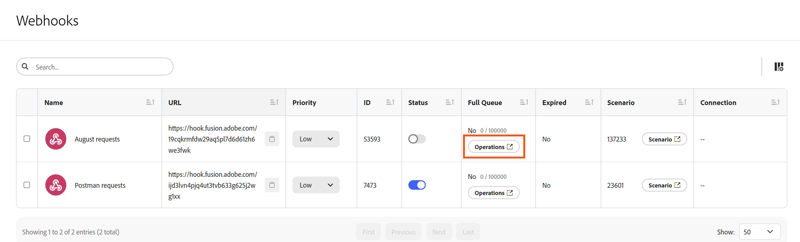

# Exibir a fila de um webhook

Muitos serviços fornecem webhooks para fornecer notificações instantâneas sempre que uma determinada alteração ocorrer no serviço. Os acionadores instantâneos, também conhecidos como webhooks, podem usar esses eventos para iniciar cenários. Os eventos entram na fila do webhook enquanto aguardam o processamento, por exemplo, quando o cenário já está em execução. Você pode exibir a fila do webhook.

Os dados de entrada do webhook são sempre armazenados na fila, independentemente de como você definiu a opção Dados são confidenciais no painel de configurações do cenário. Depois que os dados forem processados em um cenário, eles serão excluídos permanentemente da fila.

Para mais informações sobre webhooks, consulte [Acionadores instantâneos (webhooks)](/help/workfront-fusion/references/modules/webhooks-reference.md).

## Requisitos de acesso

+++ Expanda para visualizar os requisitos de acesso da funcionalidade neste artigo.

<table style="table-layout:auto">
 <col> 
 <col> 
 <tbody> 
  <tr> 
   <td role="rowheader">Pacote do Adobe Workfront</td> 
   <td> 
Qualquer pacote de fluxo de trabalho do Adobe Workfront e qualquer pacote do Adobe Workfront Automation and Integration

Workfront Ultimate

Os pacotes Workfront Prime e Select, com uma compra adicional do Workfront Fusion.
 </td> 
  </tr> 
  <tr data-mc-conditions=""> 
   <td role="rowheader">Licenças do Adobe Workfront</td> 
   <td> 
Padrão

Trabalho ou maior
 </td> 
  </tr> 
  <tr> 
   <td role="rowheader">Produto</td> 
   <td>
   
Se sua organização tiver um pacote Workfront Select ou Prime, ele não inclui o Workfront Automation and Integration. É necessário comprar o Adobe Workfront Fusion.</li></ul>
   </td> 
  </tr>
 </tbody> 
</table>

Para obter mais detalhes sobre as informações contidas nesta tabela, consulte [Requisitos de acesso na documentação](/help/workfront-fusion/references/licenses-and-roles/access-level-requirements-in-documentation.md).

+++

## Exibir a fila de um webhook

Todas as mensagens de webhooks recebidos são armazenadas na fila do webhook.

Se um cenário tiver uma fila no momento, um banner será exibido nesse cenário:

A página da fila do webhook tem o mesmo layout das listas **[!UICONTROL Cenários]** e **[!UICONTROL Webhooks]**.

>[!NOTE]
>
>A pesquisa e a classificação se aplicam somente aos eventos carregados na tabela no momento, não à fila inteira. Para incluir mais eventos, carregue os eventos adicionais primeiro.

Para exibir e gerenciar a fila de um webhook:

1. Clique em **[!UICONTROL Webhooks]** no menu à esquerda.
1. Localize o Webhook no qual deseja exibir a fila.
1. Localize o número de eventos na coluna Fila cheia.

   

1. Clique no botão **Operações** para exibir detalhes sobre os eventos na fila.

   A página da fila do webhook é aberta. A página lista os eventos na fila em uma tabela com as seguintes colunas: **[!UICONTROL ID]**, **[!UICONTROL Criado às]**, **[!UICONTROL Tamanho]** e **[!UICONTROL Detalhes]**.

1. (Opcional) Para filtrar os eventos na tabela, digite o texto no campo **[!UICONTROL Pesquisa]** acima da tabela.
1. (Opcional) Para classificar os eventos, clique no cabeçalho de coluna **[!UICONTROL ID]**, **[!UICONTROL Criado às]** ou **[!UICONTROL Tamanho]**.
1. (Opcional) Para alterar o número de eventos exibidos em cada página, selecione um número na lista suspensa **[!UICONTROL Mostrar]** na parte inferior da página.
1. (Opcional) Para se mover entre páginas de eventos, clique em **[!UICONTROL Primeiro]**, **[!UICONTROL Anterior]**, **[!UICONTROL Próximo]** ou **[!UICONTROL Último]** na parte inferior da página.

   Esses botões não estão disponíveis quando a fila tem apenas uma página de eventos.

1. (Opcional) Para exibir a carga de um evento, clique em **[!UICONTROL Detalhes]** na linha do evento.

   A caixa de diálogo de detalhes é aberta e exibe a carga útil do evento.

1. (Opcional) Para excluir eventos:

   1. Selecione os eventos que deseja excluir seguindo um destes procedimentos:

      * Marque a caixa de seleção ao lado de cada evento que você deseja selecionar.
      * Marque a caixa de seleção **[!UICONTROL Selecionar tudo]** para selecionar toda a fila, não apenas os eventos carregados atualmente. Em seguida, você pode desmarcar a caixa de seleção de todos os eventos que deseja excluir da seleção.

   1. Na barra próxima à parte inferior da tela, clique em **Excluir**.
